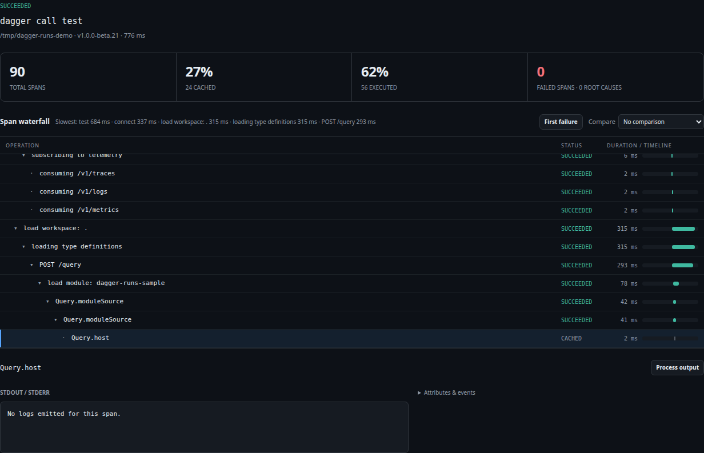
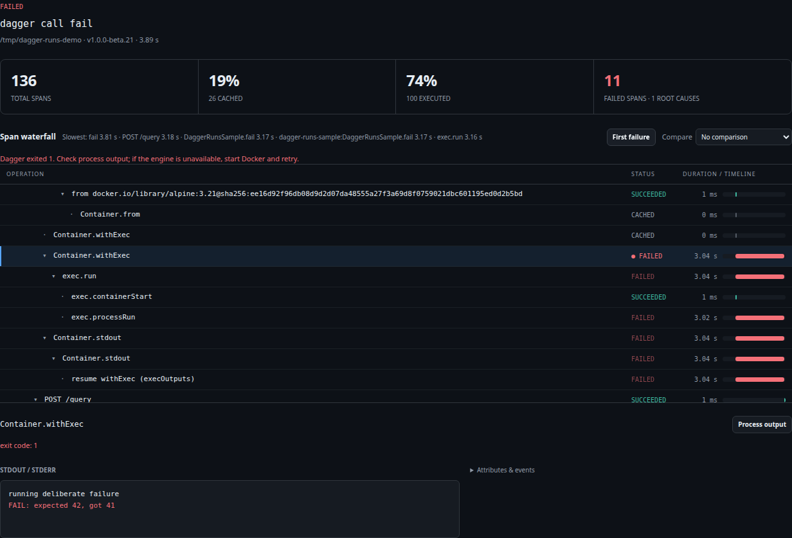

# Dagger Runs

A self-contained GitHub Copilot canvas for local Dagger CI/CD runs: live nested
spans and waterfall timing, cached operations, ANSI stdout/stderr, root-cause
failures, persistent history, and duration comparison. No Dagger login, Cloud
account, telemetry collector, frontend framework, or runtime dependency install
is needed. The Copilot runtime supplies `@github/copilot-sdk`.

## Canvas screenshots

These screenshots were captured from the actual running canvas after executing
the sample Go module with Dagger **v1.0.0-beta.21**, exporting live OTLP
HTTP/protobuf. They are not mockups or recorded-trace replays. The sample ran in
`/tmp/dagger-runs-demo`; images are cropped to the run inspector to exclude
unrelated history and personal launcher paths.



**Successful cached run.** Running `dagger call test` a second time exposes cache
reuse alongside executed work: 24 of 90 spans are cached (27%), with no failures.
Select any span to inspect its timing, attributes, and available output.



**Root-cause failure.** `dagger call fail` intentionally exits nonzero. The
inspector follows `error_origin` links to `Container.withExec`, distinguishes
one root cause from propagated failures, and shows its stdout and ANSI-colored
stderr inline.

## Install locally and open

Requires a Copilot app/runtime with experimental extension canvases, Node.js 22.13+
for local development, [Dagger](https://docs.dagger.io/install) on the runtime's
`PATH`, and a working Docker/Dagger engine. The provider and Dagger must run on
the machine whose loopback interface the app can reach.

From this repository root, install **only this folder** (do not install the SDK):

```sh
mkdir -p "${COPILOT_HOME:-$HOME/.copilot}/extensions"
cp -R "$PWD/extensions/dagger-runs" \
  "${COPILOT_HOME:-$HOME/.copilot}/extensions/dagger-runs"
```

Do not overwrite an existing installation. Use a copy, not a symlink: user
history lives under the installed folder, and symlinking the source would put
history inside the repository. Copy before installing development dependencies,
and recopy changed source files when developing. For project scope, copy it into `.github/extensions/dagger-runs/`; the
project installation shadows a user installation of the same name.

Reload extensions in a host that provides that command, or start a new Copilot
session. Ask **"Open the Dagger Runs canvas"**. Its canvas ID is `dagger-runs`.
Open input is strictly `{cwd?: string, command?: string, runId?: string}`:

```js
open_canvas({
  canvasId: "dagger-runs",
  instanceId: "pipeline-1",
  input: { cwd: "/absolute/project", command: "dagger call test" }
})
```

`cwd` and `command` **prefill** the launcher; opening or rehydrating a panel never
re-executes a command. Click **Run pipeline** or call `start_run` to start it.
Pass `runId` to reopen saved data in any panel. Closing a panel closes its UI
server, not its running pipelines. Provider shutdown cancels owned processes;
an unexpected provider crash is marked interrupted when history is reopened.
Reopening an existing panel applies new `runId`, `cwd`, and `command` inputs
over SSE, including replacing previously edited form values. Unfinished spans
in cancelled runs show cancelled; unfinished spans in failed or interrupted
runs show interrupted with stopped durations. Raw telemetry remains inspectable.

The launcher is not a shell: the first token must be exactly `dagger`.
Quoted arguments are supported; unquoted shell operators, expansions, pipes,
redirections, executable paths, and other executables are rejected. There is no
stdin/interactive terminal; put GraphQL documents in files and use `--doc`.
Commands execute with your local privileges, including Dagger's own ability to
run programs; only launch trusted commands/modules.

## Supported Dagger versions

Checked against [dagger.io](https://dagger.io/) and the upstream repository on
**2026-10-30**:

| Version | Source | Live verification |
| --- | --- | --- |
| **v0.21.11**, latest stable 0.x | [Latest GitHub release](https://github.com/dagger/dagger/releases/tag/v0.21.11), published 2026-10-21 | Build twice, cached second run, running spans, deliberate failure and inline root-cause logs; Go module test/fail |
| **v1.0.0-beta.21**, latest 1.x non-GA tag | [Upstream tag](https://github.com/dagger/dagger/tree/v1.0.0-beta.21), installed CLI reports commit `a7a2e64e` | Same live checks and Go module test/fail, plus version-specific trace replay |

The beta tag exists but does **not** have a GitHub Release resource; it is not
presented here as a GA or published GitHub prerelease. This is a verified
compatibility baseline, not a promise that future upstream versions cannot
change the experimental telemetry contract.

The launcher runs `dagger version` before starting and returns the version.
Explicit command arguments are preserved. Stable examples use `dagger call`
and `dagger query`; the beta's recommended commands are `dagger api call` and
`dagger api query` (legacy aliases may still work). Both accept `--doc` for
queries and `--progress plain`; progress output is **not parsed**, so changed
TUI/plain formats cannot corrupt the span tree.

Both versions support:

- HTTP/**protobuf**, not HTTP/JSON export from the Dagger CLI. The receiver also
  accepts OTLP JSON for portable replay. gRPC is not implemented here.
- `OTEL_EXPORTER_OTLP_PROTOCOL=http/protobuf` plus explicit
  `OTEL_EXPORTER_OTLP_TRACES_PROTOCOL` and `OTEL_EXPORTER_OTLP_LOGS_PROTOCOL`.
- Signal-specific `OTEL_EXPORTER_OTLP_TRACES_ENDPOINT` and
  `OTEL_EXPORTER_OTLP_LOGS_ENDPOINT`, including `/v1/traces` and `/v1/logs`.
  An explicit logs endpoint matters: Dagger does not infer a logs endpoint from
  `OTEL_EXPORTER_OTLP_ENDPOINT`.
- **`OTEL_EXPORTER_OTLP_TRACES_LIVE=1`** for unfinished span snapshots.
  Their end timestamps can precede their start; they are not completed spans.
- `dagger.io/dag.cached`, `dagger.io/dag.pending`, `dagger.io/dag.digest`,
  `dagger.io/module.function.name`, `stdio.stream`, and causal/error-origin
  links. Linked lazy resumptions update an API span's effective status.

Beta adds `exec.run`/`exec.processRun`, partial resumes, content-preferred digests
and cache-outcome metadata. Partial/blocked resumptions do not falsely complete
a pending API call. A content digest alone is **never** treated as a cache hit.
Beta binary `application/vnd.dagger.call+proto` log bodies are structured
function-call payloads, **not stdout**: they are counted as omitted payloads.
Encoded call/media payloads are not rendered or persisted.

The authoritative exporter behavior is in the pinned
[`otel-go` stable source](https://github.com/dagger/otel-go/blob/af7cd0684887/init.go)
and [beta source](https://github.com/dagger/otel-go/blob/132b1dd82eb2/init.go);
attribute contracts are in the corresponding `attrs.go` and Dagger's
[`engine/telemetryattrs/attrs.go`](https://github.com/dagger/dagger/blob/v1.0.0-beta.21/engine/telemetryattrs/attrs.go).
OTLP worked with both versions, so there is deliberately **no lossy
plain-progress parser/fallback**.

## Use the sample

`examples/module/` is a small Go module with `build`, `test`, and deliberate
`fail` functions. Dagger generates its Go SDK automatically; generated files
are ignored. From the repository root, use the appropriate CLI:

```sh
# Stable v0.21.11
dagger call --mod ./extensions/dagger-runs/examples/module test
dagger call --mod ./extensions/dagger-runs/examples/module test
dagger call --mod ./extensions/dagger-runs/examples/module fail

# 1.x beta
dagger api call --load-module ./extensions/dagger-runs/examples/module test
dagger api call --load-module ./extensions/dagger-runs/examples/module test
dagger api call --load-module ./extensions/dagger-runs/examples/module fail
```

Use those commands in the launcher with an absolute repository `cwd`. The last
command should fail with **"FAIL: expected 42, got 41"** after a short delay.
`examples/pipeline.graphql` also provides independent `Build`, `Test`, and `Fail`
operations without SDK generation:

```sh
dagger query --doc extensions/dagger-runs/examples/pipeline.graphql Build
dagger api query --doc extensions/dagger-runs/examples/pipeline.graphql Fail
```

Dagger itself may generate workspace lockfiles in your chosen working
directory; the extension never stores history there. If testing two CLI
versions side by side, use **separate explicitly selected engines**:
Dagger's default auto-upgrade behavior can remove a different-version default
engine. Set `DAGGER_ENGINE=container://your-engine` in the provider's environment
or use the CLI's engine-selection flags.

## External terminal export

Click **External terminal**, or invoke `prepare_external {cwd}`. It creates a
run-specific ephemeral loopback receiver and returns the exact export snippet,
for example:

```sh
export DAGGER_NO_NAG='1'
export OTEL_EXPORTER_OTLP_PROTOCOL='http/protobuf'
export OTEL_EXPORTER_OTLP_TRACES_PROTOCOL='http/protobuf'
export OTEL_EXPORTER_OTLP_LOGS_PROTOCOL='http/protobuf'
export OTEL_EXPORTER_OTLP_TRACES_LIVE='1'
export OTEL_EXPORTER_OTLP_TRACES_ENDPOINT='http://127.0.0.1:<port>/<run-capability>/v1/traces'
export OTEL_EXPORTER_OTLP_LOGS_ENDPOINT='http://127.0.0.1:<port>/<run-capability>/v1/logs'
dagger api query --doc /absolute/path/pipeline.graphql Fail
```

Replace the example endpoints with the returned values; never hardcode a port.
Unset inherited `OTEL_EXPORTER_OTLP_HEADERS` and signal-specific exporter
headers in that terminal before exporting. Launcher-created processes already
remove inherited exporter settings, headers and metrics endpoints.

After the command exits, click **Finish external run** or invoke
`finish_external {runId, failed: true}` for a nonzero terminal exit. Failed span
telemetry is detected automatically, but the receiver cannot infer a terminal
process's exit code. External version metadata is learned from received client
attributes. **Cancel** for an external run only closes the receiver: stop that
terminal process with Ctrl-C yourself. The export endpoints expire on finish,
cancel, provider reload or shutdown.

## Canvas actions and result shapes

All action/open schemas reject unknown fields and validate required fields and
types. Errors throw `CanvasError("dagger_runs_error", message)`; successful
handlers return raw values, not success-shaped wrappers.

| Action | Input | Result |
| --- | --- | --- |
| `start_run` | `{cwd: string, command: string}` | `{runId, version}` |
| `cancel_run` | `{runId: string}` | `{runId, status: "cancelling"}` for owned processes; external receivers finish as cancelled |
| `get_run` | `{runId: string}` | Metadata, status, `durationMs`, errors, `tree: {roots, nodes}`, summary |
| `list_runs` | `{limit?: integer}` (1-100; default 20) | Newest run summaries, without spans/logs |
| `get_span_logs` | `{runId: string, spanId: string}` | `{spanId, entries: [{stream,text,time}], bytes, truncated}` |
| `get_failures` | `{runId: string}` | `{runId,status,errors,rootCauseIds,failedSpans,processLogs}` |
| `prepare_external` | `{cwd: string}` | `{runId,endpoint,snippet,note}` |
| `finish_external` | `{runId: string, failed?: boolean}` | `{runId,status}` |

```js
invoke_canvas_action({
  instanceId: "pipeline-1",
  actionName: "start_run",
  input: { cwd: "/absolute/project", command: "dagger api call test" }
})
// Then get_run / get_failures using the returned runId.
```

`tree.nodes` is a flat, structured adjacency tree: every node includes composite
`id` (`traceId:spanId`), `parentId`, `children` IDs, name, effective status,
duration, attributes, events, links, error-origin IDs and `rootCause`.
Composite IDs isolate duplicate span IDs across traces. `get_span_logs` also
accepts a unique bare span ID, or `"process"` for launcher stdout/stderr.
Out-of-order/missing parents remain visible; cyclic parent graphs cannot
recurse forever.

`get_failures` puts error-origin root causes **first**, with their logs inline.
Ancestors and duplicate propagated failures are marked `propagated: true`;
the UI de-emphasizes them and auto-expands/scrolls to the root-cause operation.
Known registry 401 authentication challenges are recovered diagnostics. A
successful process reports **zero failed spans**; diagnostic error records
remain inspectable via `rawStatus`, `recovered`, attributes and events.
The header distinguishes failed span count from root-cause count.

The header also shows total spans, cached count/percentage, executed
count/percentage, and five slowest spans. Compare a historical run to see total
duration delta and the slowest named operations. Tree navigation: Up/Down,
Left/Right to collapse/expand, Home/End, Enter/Space to inspect. The viewport
virtualizes rows; ingestion/SSE notifications are batched at 200 ms, with a
250 ms live timer.

## Storage, security and bounds

- History is per-user under
  `$COPILOT_HOME/extensions/dagger-runs/artifacts/` (default
  `~/.copilot/extensions/dagger-runs/artifacts/`), **never the repository or
  panel ID**. One atomic mode-0600 JSON file per run prevents simultaneous
  providers overwriting one another. Live foreign owners are not marked
  interrupted. Active telemetry is checkpointed every 300 ms rather than
  waiting for a quiet stream; write failures are explicit and retry dirty data.
  Providers refresh shared history every two seconds.
- The default retention is **20 completed runs**, plus active runs.
  Only the owning provider can cancel a launched process. Run IDs can be read
  from any provider/panel sharing the same user store.
- Both UI and OTLP servers bind **127.0.0.1:0 only**. OS-selected ports avoid
  fixed-port collisions. Host/Origin checks, opaque per-server capability
  paths, CSP, no CORS, and request/decompression limits protect the endpoints.
  Local processes running as your user remain trusted; these are not
  authenticated remote services.
- Only a `dagger` first token is accepted. `spawn` uses `shell: false`.
  POSIX cancellation signals the process group and escalates after two
  seconds; Windows uses `taskkill /PID ... /T /F`. Provider shutdown waits for
  owned process cleanup.
- Env-derived secret values and attribute names matching
  `/token|secret|password|key/i` are redacted before storage/rendering, as are
  authorization/cookie/credential attributes and recognizable secret
  assignments. Sensitive CLI argument values are captured for masking.
  Git identity/machine metadata, encoded call payloads, and binary media are
  omitted. Do not deliberately print unlabelled secrets: arbitrary text cannot
  reliably be classified as secret by any name-based redactor.
- Logs are capped at **1 MiB and 10,000 records per span**, **16 MiB per run**,
  with explicit truncation flags. Requests/decompressed OTLP bodies are capped
  at 16 MiB; runs at 100,000 spans and four active receivers per provider.
  Truncated logs and dropped-span counts are visible, not silent.
- Missing Dagger includes its install URL. Engine/Docker failures and crashed
  processes retain process output and explicit errors. Malformed OTLP returns
  HTTP 400 and records a bounded diagnostic, without echoing raw JSON.
  Cloud trace URLs are shown only when emitted; setup/signup URLs are not
  mislabeled as traces. The extension neither logs in nor uploads telemetry.

## Development and verification

Runtime: **zero installed dependencies**. Development-only lint packages are
exactly pinned in `package.json`/lockfile; they are not imported by the provider.

```sh
cd extensions/dagger-runs
npm ci --ignore-scripts
npm run lint
npm test
node dev.mjs
```

`dev.mjs` prints a capability URL for the **same renderer/actions** used by the
canvas; stop it with Ctrl-C. It is not proof of host canvas registration.

`npm test` exercises out-of-order/missing-parent/cached/live/lazy spans,
root-cause ranking, recovered diagnostics, binary call-payload filtering,
redaction, limits, HTTP guards, schema failures, multi-provider history,
crashed processes, cancellation of a SIGTERM-ignoring descendant, and **recorded
live traces from both supported versions replayed through the real receiver**.

With Dagger/Docker available, run the real pipeline twice for cache and then
failure (no account needed):

```sh
npm run test:live
DAGGER_RUNS_BINARY=/absolute/path/to/stable/dagger npm run test:live
```

Use `DAGGER_ENGINE` to select the corresponding engine. Set
`DAGGER_RUNS_RECORD=1` to refresh sanitized version-specific fixtures; generated
workspaces/history for these tests are temporary and removed afterward.

The optional `test/browser.mjs` uses Playwright, supplied separately rather than
adding it to runtime dependencies:

```sh
# Point to an installed Playwright module with its Chromium browser available.
PLAYWRIGHT_MODULE=/absolute/path/to/playwright/index.mjs \
DAGGER_RUNS_SCREENSHOT="$PWD/screenshots/failed-run.png" \
node test/browser.mjs
```

This verifies actual DOM row virtualization for 2,500 spans, keyboard
navigation, ANSI color safety, root-cause auto-focus, history comparison and
light/dark rendering. It replays real captured traces, not fabricated failures.

For host verification, separately reload/list/inspect the extension, call
`list_canvas_capabilities`, open it, invoke **every action**, reject invalid
input, and verify reserved `canvas.open` action rejection. This authoring
environment did not expose `extensions_manage`/`extensions_reload`; the
scaffold-equivalent implementation was explicitly approved, canonical bundled
SDK docs/types were read, and local renderer/receiver checks are not claimed as
those unavailable runtime RPC checks. A subsequent fresh-session host check
verified discovery, opening, all eight actions, cache, root-cause logs,
cancellation, invalid inputs, and reserved-action/security rejections.

## Limitations

The SDK canvas API is experimental. This is an OTLP execution inspector, not a
full replica of Dagger's specialized TUI (media, metrics, recipe decoding,
interactive shells and every future attribute are outside its scope).
Legitimately unevaluated lazy operations can remain pending after a successful
run. Timing uses millisecond JavaScript numbers, not nanosecond precision.
Comparison matches displayed names, not semantic call identity.
External runs require manual finish; their terminal processes are not owned
by the extension. Windows cancellation is implemented but live verification
was performed on Linux. A provider crash cannot reattach to an old process;
history explicitly marks interruption instead.

Extensions are discovered when a session starts; use a fresh session or a
capable host's reload command after installation or provider changes.
Installation does not modify the app or require public sharing.
